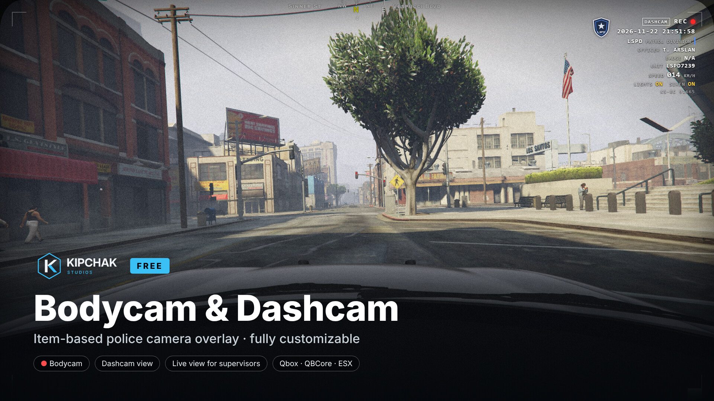
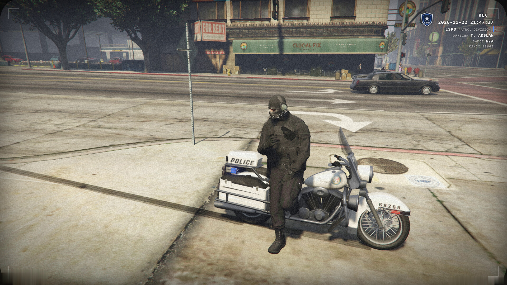
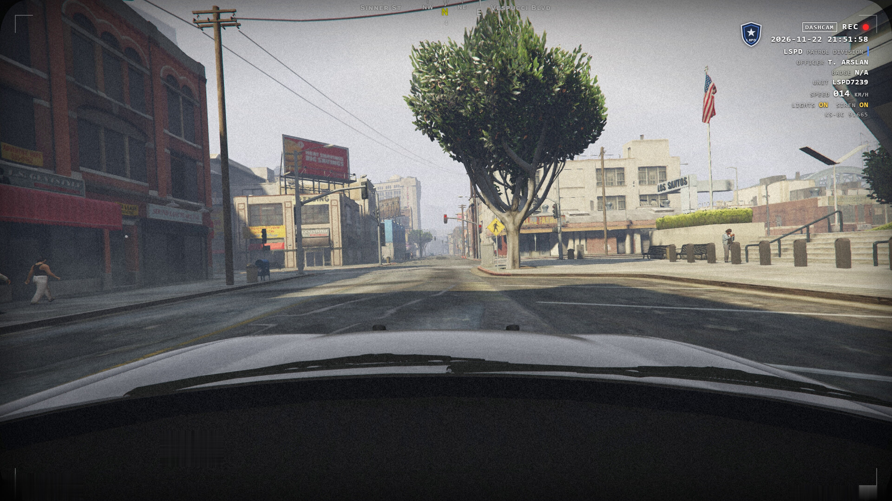
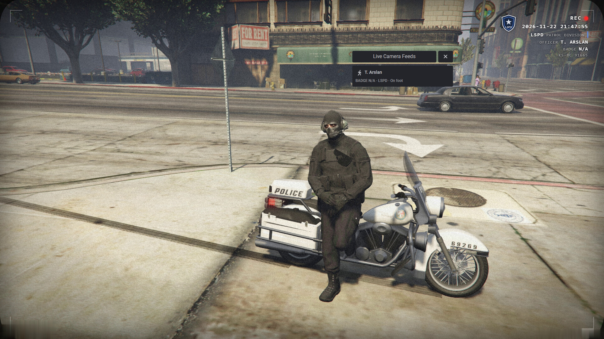
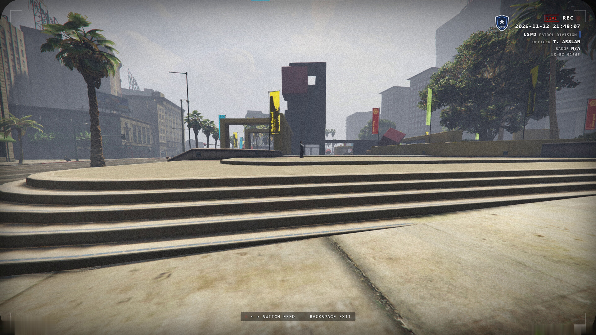
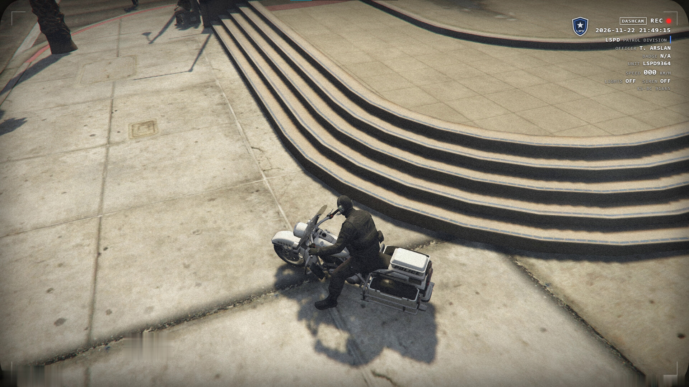
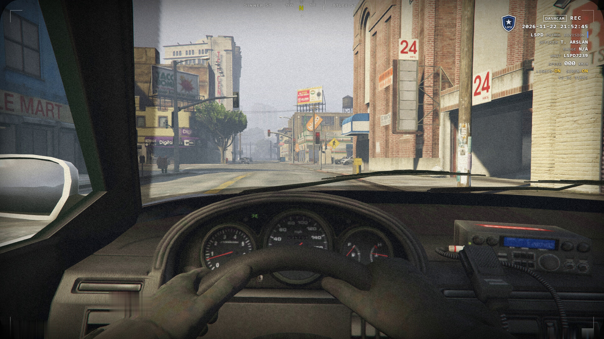

# Kipchak Bodycam



**[Download on Tebex](https://kipchak.tebex.store)** · **[Discord](https://discord.gg/jfaacuje8f)** · **[Calibrix – Forensic Ballistics Lab](https://kipchak.tebex.store)**

A free, lightweight body camera and dashcam overlay for FiveM emergency services, made by **Kipchak Studios**.

When an officer switches the body camera on, a recording overlay appears on screen. It shows a blinking REC dot, the date and time, the officer's name, badge or callsign, department and a device serial number. In an emergency vehicle the overlay switches to dashcam mode with unit, speed, lights and siren. Supervisors can watch any active camera live from a station terminal.

The default look is built for streamers and content creators: clean white monospace text, soft shadows and subtle lens effects. You can change all of it from the config.

## Screenshots

| Bodycam | Dashcam camera |
| --- | --- |
|  |  |
| **Live view list** | **Live view feed** |
|  |  |
| **Dashcam overlay** | **In-car view** |
|  |  |

## Features

- Recording overlay in any screen corner: blinking REC dot, date and time (real or in-game), officer name, badge or callsign, department and a per-character device serial (for example `KS-BC 04821`)
- A department profile for each job: name, subtitle, logo, accent color and badge label
- Lens effects: vignette, film grain, rounded lens frame with corner marks, and an optional game timecycle filter. You can turn each one on or off and set its strength
- Turned on and off **only by using the item**. The camera stays on until the player uses the item again
- Remembers the camera state across reconnects (resource KVP, no database table)
- Turns off when the item leaves the inventory. Turning off on death, cuffing or losing the job is optional
- Dashcam mode in emergency vehicles, plus an optional fixed dashcam camera angle that has its own key
- **Live view** (free): authorized ranks can watch active cameras, with server side permission checks and OneSync focus streaming
- A short beep when the camera turns on or off. The beep is generated in the browser (no audio files) and plays only for the player and, if enabled, players nearby
- A state bag, exports and an event that other resources can use
- Optional Discord logs
- English and Turkish locales
- Qbox, QBCore and ESX, detected automatically

## Requirements

- [ox_lib](https://github.com/overextended/ox_lib)
- Qbox, QBCore or ESX
- ox_inventory, qb-inventory (or a compatible inventory) or the ESX default inventory
- **OneSync** (Legacy or Infinity) is required for **live view**. The overlay, dashcam and item work without it, but live view needs the server to read player positions and stream remote players to the viewer.

## Installation

1. Copy `kipchak_bodycam` into your resources folder.
2. Add the `bodycam` item to your inventory (see [Item setup](#item-setup)).
3. Copy `install/bodycam.png` into your inventory's image folder.
4. Add `ensure kipchak_bodycam` to your `server.cfg` **after** `ox_lib`, your framework and your inventory.
5. Review `config.lua`. Discord logs are set in `server/sv_config.lua`.

## Item setup

### ox_inventory (`ox_inventory/data/items.lua`)

```lua
['bodycam'] = {
    label = 'Body Camera',
    weight = 250,
    stack = false,
    close = true,
    consume = 0,
    description = 'Chest-mounted recording device',
    server = {
        export = 'kipchak_bodycam.bodycam'
    }
},
```

`consume = 0` stops the item from being used up. If you rename the item in `Config.Item`, change the export to match, for example `kipchak_bodycam.my_item_name`.

### qb-inventory / QBCore (`qb-core/shared/items.lua`)

```lua
bodycam = { name = 'bodycam', label = 'Body Camera', weight = 250, type = 'item', image = 'bodycam.png', unique = true, useable = true, shouldClose = true, description = 'Chest-mounted recording device' },
```

### ESX (SQL)

```sql
INSERT INTO `items` (`name`, `label`, `weight`, `rare`, `can_remove`) VALUES ('bodycam', 'Body Camera', 1, 0, 1);
```

On ESX with ox_inventory, use the ox_inventory entry above instead.

## Usage

| Action | How |
| --- | --- |
| Turn camera on/off | Use the `bodycam` item |
| Hide/show overlay only | Optional keybind (`Config.HideOverlayKey`), off by default |
| Dashcam camera angle | `J` by default while in an emergency vehicle with the camera on (change it in FiveM Settings > Key Bindings > FiveM) |
| Live view | `/bodycamview` |
| Live view controls | `←` / `→` switch officer, `BACKSPACE` exit |

There is intentionally no command to turn the camera on or off.

## Configuration

All options are in `config.lua`. You can turn every feature on or off there.

### General

| Option | Default | Description |
| --- | --- | --- |
| `Config.Framework` | `'auto'` | `'auto'`, `'qbox'`, `'qbcore'` or `'esx'` |
| `Config.Inventory` | `'auto'` | `'auto'`, `'ox'`, `'qb'` or `'esx'` |
| `Config.Locale` | `'en'` | `'en'` or `'tr'` |
| `Config.Item` | `'bodycam'` | Item name |
| `Config.AllowedJobs` | police, sheriff, ambulance = 0 | Job → minimum grade. Leave the table empty (`{}`) so anyone with the item can use it |
| `Config.RequireOnDuty` | `false` | The player must be on duty to turn the camera on |
| `Config.RememberState` | `true` | A camera left on is turned back on after reconnecting |
| `Config.TurnOffWhenItemRemoved` | `true` | Turns the camera off when the item is given away, dropped or confiscated |
| `Config.TurnOffWhenUnauthorized` | `true` | Turns the camera off when the player loses the job, grade or duty status |
| `Config.TurnOffOnDeath` | `false` | Turns the camera off when the player dies or is downed |
| `Config.TurnOffOnCuff` | `false` | Turns the camera off when the player is cuffed |
| `Config.CheckInterval` | `2000` | How often (ms) the server checks active cameras for the rules above |
| `Config.ShowInThirdPerson` | `true` | `false` shows the overlay only in first person (and in the dashcam camera) |
| `Config.HideInPauseMenu` | `true` | Hides the overlay in the pause menu |
| `Config.HideOverlayKey` | off | `Enabled = true` registers a keybind that hides only the overlay. `Key = ''` leaves it unbound so players choose a key themselves |
| `Config.Notify.Enabled` | `true` | Small notification on toggle |
| `Config.Sound.Enabled` | `true` | Short beep on toggle |
| `Config.Sound.Volume` | `0.25` | Beep volume (0-1) |
| `Config.Sound.Nearby` | off, 6.0 | Players within this distance also hear the beep, quieter with distance. It is never sent to the whole server |
| `Config.Badge.MetadataKey` | `'callsign'` | Player metadata key used for the badge or callsign |
| `Config.Badge.Fallback` | `'N/A'` | Shown when the player has no badge or callsign (only if `HideWhenEmpty` is `false`) |
| `Config.Badge.HideWhenEmpty` | `true` | Hides the badge row when the player has no badge or callsign |

### Date and time

| Option | Default | Description |
| --- | --- | --- |
| `Source` | `'real'` | `'real'` uses the server clock, `'game'` uses the in-game clock |
| `Format` | `'YYYY-MM-DD HH:mm:ss'` | Tokens: `YYYY YY MM DD HH hh mm ss A`. Example: `'DD.MM.YYYY HH:mm'` |
| `Use12Hour` | `false` | Switches `HH` to 12-hour format and adds AM/PM |
| `TimezoneOffset` | `0` | Hours added to UTC server time, for example `3` for UTC+3 |

### Overlay

| Option | Default | Description |
| --- | --- | --- |
| `Position` | `'top-right'` | `'top-left'`, `'top-right'`, `'bottom-left'`, `'bottom-right'` |
| `OffsetX` / `OffsetY` | `0` | Extra distance from the corner, in pixels at 1080p (scales with resolution) |
| `Scale` | `1.0` | Overall size |
| `Font` | `'mono'` | `'mono'`, `'courier'`, `'sans'`, `'condensed'`, `'custom'` or any CSS font-family string |
| `TextColor` | `'#ffffff'` | Text color |
| `Uppercase` | `true` | Shows all text in capitals |
| `NameFormat` | `'initial'` | `'initial'` (J. Doe), `'full'` (John Doe), `'last'` (Doe) |
| `Shadow` / `ShadowStrength` | `true` / `0.85` | Text shadow |
| `RecColor` / `RecBlinkSpeed` | `'#ff2b2b'` / `1.0` | REC dot color and blink cycle in seconds |
| `Strip` | off, 0.35 | Dark background panel behind the text |
| `Fields` | all `true` | Show or hide each line: `Rec`, `ModeLabel`, `DateTime`, `Department`, `Officer`, `Badge`, `Serial`, `Unit`, `Speed`, `Lights`, `Siren` |
| `Labels` | all `false` | `false` uses the locale text. Set a string to override it, for example `Rec = 'RECORDING'` |

`Config.Serial` sets the serial prefix (`'KS-BC'`) and whether the serial is shown. The number is generated from the character identifier, so it stays the same for each character.

### Effects

`Config.Effects.Vignette`, `Grain` and `Frame` each have `Enabled` and `Intensity` (0-1). They are pure CSS, with no game post-processing. `Timecycle` applies a game timecycle modifier while the overlay is visible (`Enabled = false` by default, with `Modifier` and `Strength` settings).

### Dashcam

| Option | Default | Description |
| --- | --- | --- |
| `Enabled` | `true` | `false` disables dashcam mode entirely |
| `VehicleClasses` | `{ 18 }` | Vehicle classes that count as emergency vehicles (18 = emergency) |
| `Models` | `{}` | Extra model names, for example `{ 'police5', 'fbi2' }` |
| `SpeedUnit` | `'kmh'` | `'kmh'` or `'mph'` |
| `UnitSource` | `'plate'` | `'plate'` or `'callsign'` |
| `UnitNames` | `{}` | Per-model unit names that override the source, for example `{ police3 = 'TRAFFIC 7' }` |
| `Camera.Enabled` | `true` | Fixed dashcam camera angle on a key |
| `Camera.Key` | `'J'` | Default key (players can rebind it) |
| `Camera.Fov` | `70.0` | Field of view |
| `Camera.DefaultOffset` | `vec3(0.0, 0.45, 0.62)` | Camera position relative to the vehicle center (x right, y forward, z up) |
| `Camera.Offsets` | `{}` | Per-model offsets |

### Live view

| Option | Default | Description |
| --- | --- | --- |
| `Enabled` | `true` | `false` disables the whole feature and its command |
| `Command` | `'bodycamview'` | Command name |
| `MinGrade` | `3` | Minimum grade to watch feeds |
| `Jobs` | police, sheriff | Jobs allowed to watch. `true` uses `MinGrade`, a number sets a grade for that job |
| `RequireOnDuty` | `true` | The viewer must be on duty |
| `Locations` | `{}` | Station terminals. Leave empty to allow viewing anywhere. Entries are `vec3(...)` or `{ coords = vec3(...), radius = 2.0 }` |
| `LocationRadius` | `2.0` | Default terminal radius |
| `SameJobOnly` | `false` | Viewers only see cameras from their own job |
| `NotifyTarget` | `false` | Tells the watched officer "Your camera is being viewed live" |
| `Fov`, `BodyOffset`, `BodyPitch` | | Body camera viewpoint used for live view |
| `SignalTimeout` | `10` | Seconds without the target streamed in before the feed ends |
| `AllowSelfView` | `false` | **Debug only.** Lets a viewer watch their own camera, which is useful for testing alone |

Example terminal:

```lua
Config.LiveView.Locations = {
    { coords = vec3(441.2, -978.9, 30.7), radius = 1.5 }
}
```

## Customization

### Change a department logo

1. Put your image (`.png`, `.svg`, `.webp`) in `html/logos/`, for example `html/logos/mypd.png`.
2. In `config.lua`, set `logo = 'mypd.png'` in that job's profile. A full `https://` URL also works.
3. Restart the resource.

`Config.Logo` sets the size (pixels at 1080p), position next to the text (`'left'`, `'right'`, `'top'`, `'bottom'`) and opacity. `Config.Logo.Enabled = false` hides all logos. `logo = false` in a profile hides only that department's logo.

The included LSPD, BCSO, SAHP and EMS logos are simple placeholders made for this resource. Replace them with your own artwork.

### Add a department profile

The key is the job name:

```lua
Config.Departments.fib = {
    label = 'FIB',
    subtitle = 'Field Office',
    logo = 'fib.png',
    color = '#7fd1ff',
    badgeLabel = 'AGENT'
}
```

Add the job to `Config.AllowedJobs` as well. Jobs without a profile use `Config.DefaultDepartment`, which shows the framework job label.

### Use your own font

1. Put the font file in `html/fonts/`, for example `html/fonts/MyFont.woff2`.
2. Set:

```lua
Config.Overlay.Font = 'custom'
Config.Overlay.CustomFont = { File = 'MyFont.woff2', Family = 'MyFont' }
```

Only use fonts whose license allows redistribution.

### Adjust the dashcam camera for a vehicle

Enter the vehicle with the camera on, press the dashcam key and check the view. Then add an offset for that model:

```lua
Config.Dashcam.Camera.Offsets = {
    police3 = vec3(0.0, 0.30, 0.70)
}
```

Increase `y` to move the camera forward and `z` to move it up. The same offset is used for live view.

### CSS variables

`html/style.css` starts with a `:root` block of CSS variables, such as `--bc-color`, `--bc-accent`, `--bc-font`, `--bc-scale`, `--bc-rec-color`, `--bc-rec-speed`, `--bc-strip`, `--bc-logo-size`, `--bc-vignette`, `--bc-grain` and `--bc-frame-*`. The config values are written to these variables at runtime. Advanced users can restyle the overlay in `style.css` without touching the Lua code.

## Live view: how it works

- The server checks permissions every time a viewer opens the list, starts a feed, switches feeds and once per second while watching. The client only sends the ID it picked from the server's list, and the server checks it again.
- The viewer's camera attaches to the target's chest, or to the dashcam position when the target is in an emergency vehicle. The viewer sees the same overlay with the target's details and a LIVE tag.
- Remote players may not be loaded on the viewer's client. The viewer's streaming focus moves to the target's server side position (`SetFocusPosAndVel`), so OneSync streams the target in. The target is then resolved by server ID or network ID and followed with `SetFocusEntity`.
- The viewer's own ped is frozen while watching. Leaving the feed restores the camera, focus and controls.
- The feed ends when the target turns the camera off, disconnects, moves to another routing bucket, or cannot be streamed within `SignalTimeout`.
- Nothing is recorded. Live view is a live feed only.

## Exports and events

### Server

```lua
exports.kipchak_bodycam:IsBodycamOn(source)
exports.kipchak_bodycam:SetBodycam(source, true)

AddEventHandler('kipchak_bodycam:toggled', function(source, state, reason)
end)
```

`reason` is one of `item`, `restore`, `export`, `item_removed`, `unauthorized`, `dead`, `cuffed`, `unload` or `dropped`. `SetBodycam` does not check the item or job, so the calling resource decides.

### Client

```lua
exports.kipchak_bodycam:IsBodycamOn()
exports.kipchak_bodycam:IsViewingLive()
```

### State bag

```lua
Player(source).state.bodycam
LocalPlayer.state.bodycam
```

The server owns the state bag. Changes made by clients are reverted.

## Discord logs

Set `SvConfig.Webhook` in `server/sv_config.lua`. `SvConfig.Logs.Toggle` logs cameras turning on and off. `SvConfig.Logs.LiveView` logs when live view starts and ends. The webhook is empty by default, so nothing is sent.

## Credits and licenses

- Code, placeholder logos and item icon: original work by Kipchak Studios, MIT License (see `LICENSE`)
- Sounds: generated at runtime with the Web Audio API, no audio files included
- Fonts: system fonts only, no font files included

## Support

- Discord: https://discord.gg/jfaacuje8f
- Store: https://kipchak.tebex.store

Looking for evidence work too? Check out **Calibrix – Forensic Ballistics Lab** on our store.
